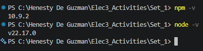
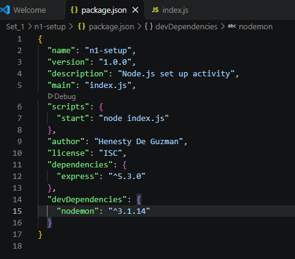
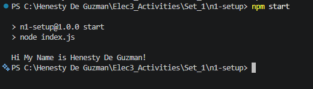
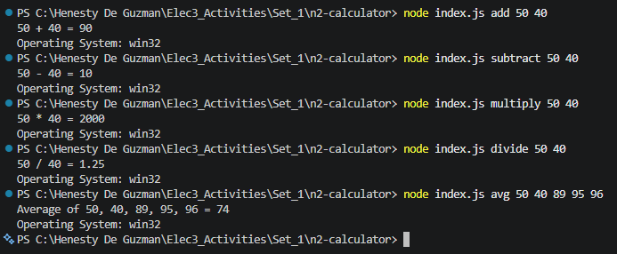
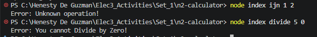
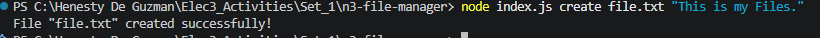
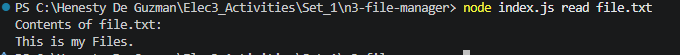
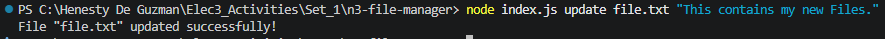
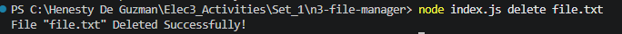
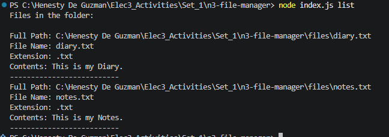

# ELEC 3 - Node.js

## Student Information

- Name: Henesty G. De Guzman
- Section: IV-BSIT A
- Course: ELEC 3 - Node.js

## About

This repository contains my Set 1 activities for the self-paced learning assignment in Node.js. Through these activities, I practiced setting up a Node.js project, creating and using modules, and working with files.

## Set 1 Activities

| Activity | Description |
| --- | --- |
| [N1 - Project Setup and Package Management](set1/n1-setup/) | Sets up a Node.js project and uses npm packages. |
| [N2 - Modular Calculator](set1/n2-calculator/) | Performs calculations using separate modules. |
| [N3 - File Manager](set1/n3-file-manager/) | Creates, reads, updates, deletes, and lists text files. |

## How to Run

Make sure Node.js and npm are installed. Open CMD or the terminal in the repository folder. Start each activity from the repository root unless you are already in its activity folder.

## N1 - Project Setup and Package Management

In this activity, I practiced initializing a Node.js project, installing packages, and using the start script in package.json.

### Commands

```cmd
cd set1/n1-setup
npm install
npm start
```

After running the activity, return to the repository folder using `cd ../..`.

### Written Answers

[N1 - Package Management Answers (PDF)](set1/n1-setup/N1_answers.pdf)

### Program Output

Version Check



Package Configuration



NPM Start Output



## N2 - Modular Calculator

I created a calculator with separate modules for calculations and formatting the results. The program accepts the operation and numbers through the command line. It also handles division by zero and unknown operations.

### Commands

```cmd
cd set1/n2-calculator
node index.js add 12 8
node index.js subtract 12 8
node index.js multiply 12 8
node index.js divide 12 8
node index.js average 12 8
node index.js divide 12 0
node index.js unknown 12 8
```

Return to the repository folder using `cd ../..`.

### Program Output

Calculator Operations



Error Handling



## N3 - File Manager

In this activity, I used the fs and path modules to manage text files. The program allows users to create, read, update, delete, and list files using command-line arguments.

### Commands

```cmd
cd set1/n3-file-manager
node index.js create demo.txt "Hello"
node index.js read demo.txt
node index.js update demo.txt "Additional text"
node index.js list
node index.js delete demo.txt
node index.js list
```

I used demo.txt in the example so the existing sample files are not affected. Return to the repository folder using `cd ../..`.

### Program Output

Create File



Read File



Update File



Delete File



List Files



## Reference

- [Traversy Media - Node.js Crash Course](https://www.youtube.com/watch?v=32M1al-Y6Ag)
